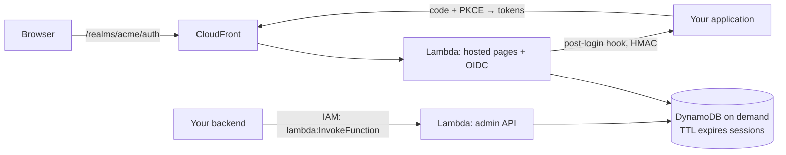

# cdk-serverless-idp

[Leia em português](README.pt-BR.md)

A **multi-tenant OpenID Connect identity provider** for your SaaS, as one AWS CDK construct. It runs on Lambda and
DynamoDB, so it **costs nothing while nobody is signing in**: there is no server to keep on, no NAT and no database
instance. It is built for teams starting their own SaaS who want a safe path to follow.

- **Realm per customer.** Each customer (school, clinic, company…) gets its own people, password and two-step
  policies, social login and branding.
- **Application per SaaS.** Every product you build signs in through the same provider. A person signed in to one
  application of a realm is signed in to the others (SSO).
- **Post-login hooks.** Each application decides what the person can do in it. After authentication the provider asks
  the application (HTTPS signed with HMAC, or a Lambda) whether to allow the sign-in and which claims to add. The
  provider itself knows nothing about your domain: roles, plans and permissions stay in your application.
- **Standards, not homemade crypto.** Built on [`oidc-provider`](https://github.com/panva/node-oidc-provider), certified
  by the OpenID Foundation. Authorization code with **mandatory PKCE**, refresh token rotation with **reuse detection**,
  ES256 keys with rotation, revocation, introspection and RP-initiated logout.



## What is inside

| | |
|---|---|
| **Sign-in** | Email and password (argon2id), two-step verification (TOTP, recovery codes, enrollment enforced by the realm), Google and Facebook login, password reset, invites. |
| **Hosted pages** | Sign-in, second factor, consent (third-party applications), password reset, invite and an account console (change password, turn two-step verification on or off). Plain HTML with no JavaScript at all, so the CSP has no `script-src`. Portuguese and English, with realm colors and logo. |
| **Protection** | Rate limits per e-mail and per IP, the same answer for wrong password and unknown e-mail (constant-time check), CSRF tokens on every form, `SameSite` cookies, HSTS, `frame-ancestors 'none'`, CloudFront origin secret (the Function URL refuses direct calls), a new password ends every session, and an audit trail per realm. |
| **Admin API** | IAM only (`lambda:InvokeFunction`), with no public admin route: realms, applications, people, bulk import (argon2 hashes, TOTP secrets and social identities from your old system), invites, key rotation and the audit trail. |
| **Infrastructure** | One DynamoDB table (on demand, TTL, point-in-time recovery), two ARM Lambdas, CloudFront with your domain, Secrets Manager for keys, SES for e-mail. The first deployment creates the keys by itself. |

## Quick start

```bash
npm install cdk-serverless-idp
```

```ts
import { ServerlessIdp } from 'cdk-serverless-idp';

const idp = new ServerlessIdp(stack, 'Idp', {
  domainName: 'id.example.com',
  certificate, // ACM certificate in us-east-1
  mailFrom: 'Example <no-reply@example.com>', // verified in SES
  productName: 'Example',
});
idp.grantAdmin(backendFunction); // your backend manages realms, apps and people
```

After `cdk deploy`, point `id.example.com` (CNAME) to the `DistributionDomainName` output. Then create a realm, an
application and a person through the admin API, for example with the AWS CLI:

```bash
fn=<AdminFunctionName output>
invoke() { aws lambda invoke --function-name "$fn" --cli-binary-format raw-in-base64-out --payload "$1" /dev/stdout; }
invoke '{"action":"putRealm","realm":{"id":"acme","displayName":"Acme","mfa":"optional"}}'
invoke '{"action":"putClient","client":{"clientId":"my-saas","name":"My SaaS","redirectUris":["https://app.example.com/callback"],"realms":["*"],"firstParty":true,"hook":{"url":"https://app.example.com/idp-hook","secret":"<random>","onError":"deny"}}}'
invoke '{"action":"upsertUser","realm":"acme","user":{"email":"ana@acme.com","name":"Ana"}}'
invoke '{"action":"invite","realm":"acme","id":"<user id>"}'
```

The application uses any OpenID Connect client library with the issuer `https://id.example.com/realms/acme`
(discovery at `/.well-known/openid-configuration`). The first `putClient` returns the client secret: store it, because
it is not shown again (`rotateClientSecret` makes a new one).

### Post-login hook

```ts
// POST https://app.example.com/idp-hook  (X-Idp-Timestamp, X-Idp-Signature: sha256=HMAC(secret, `${ts}.${body}`))
{ "event": "login" | "token", "realm": "acme", "clientId": "my-saas", "method": "password",
  "user": { "sub": "…", "email": "ana@acme.com", "name": "Ana", "emailVerified": true } }
// answer
{ "allow": true, "claims": { "my-saas:role": "admin", "my-saas:plan": "pro" } }
```

The hook runs at the end of every sign-in and on every access token, including refreshes. A role change or a cancelled
plan therefore applies at the next refresh, which happens within 15 minutes. Only claims with the application's prefix
are kept. A hook that fails or times out (2 s by default, up to 10 s for applications with slow cold starts) denies the sign-in, unless the application sets `onError: "allow"`.

## Cost

You pay for requests, not for time:
- Lambda invocations;
- DynamoDB on-demand reads and writes (TTL deletes expired sessions and tokens for free);
- CloudFront;
- two Secrets Manager secrets;
- SES e-mails.

A few thousand sign-ins a month stay in cents, plus the secrets (about US$ 0.80/month). With no sign-ins, the bill is
the secrets.

## Limits and choices

- Realm ids are lowercase letters, digits and `-` (they appear in URLs).
- No self sign-up: applications create people through the admin API (invites), and social login only signs in
  existing people. If the realm allows it, it links them by verified e-mail.
- One provider per region and stack.
- A sign-in round trip (six HTTP hops plus argon2id) takes about 2.5 s on a cold start and well under that warm.

## Prior art

[Keycloak](https://www.keycloak.org/), [Zitadel](https://zitadel.com/), [Authentik](https://goauthentik.io/) and
[Ory](https://www.ory.sh/) are complete, mature identity platforms that run as always-on services.
[Amazon Cognito](https://aws.amazon.com/cognito/) and [Auth0](https://auth0.com/) are managed services billed per
active user. This construct is narrower on purpose: the sign-in your SaaS needs, multi-tenant from day one, scale to
zero, and the code in your account.

## Security

See [SECURITY.md](SECURITY.md) for the threat model and how to report a vulnerability.

## License

[Apache-2.0](LICENSE)
